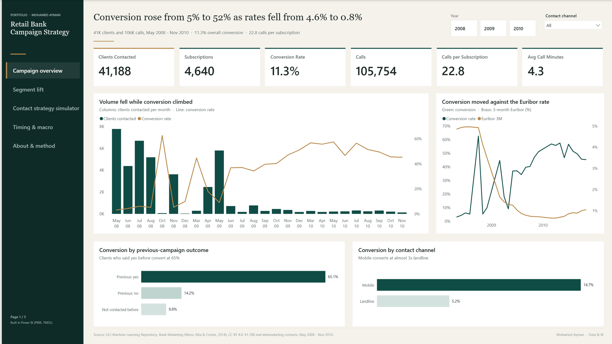
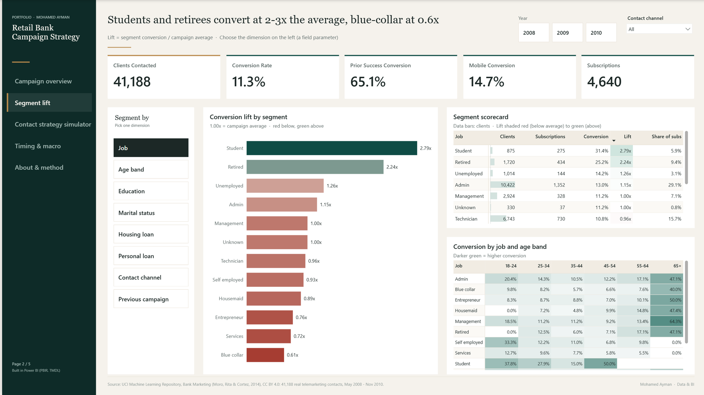
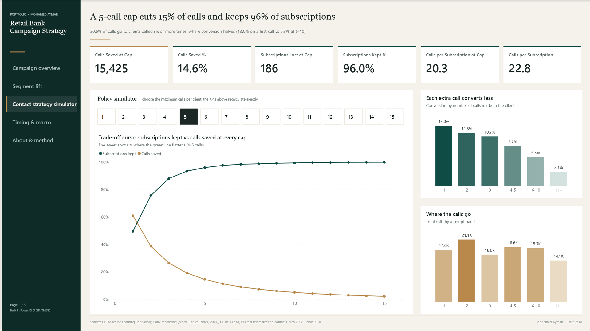
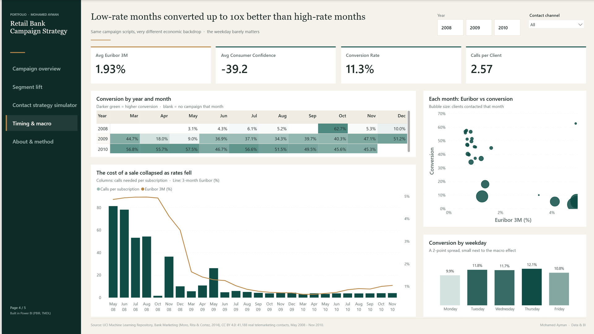
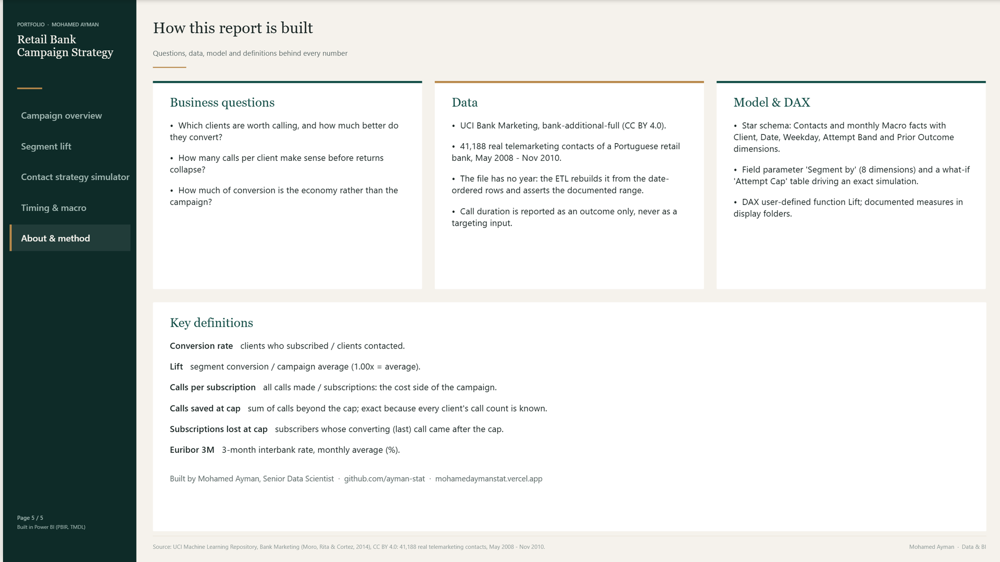

# Retail Bank Campaign Strategy

Who to call, how often, and how much of conversion is the economy: 41K real telemarketing contacts of a Portuguese retail bank.

**Domain:** Banking / direct marketing  ·  **Built with:** Power BI Desktop (PBIP, PBIR, TMDL), DAX, Python  ·  **Author:** [Mohamed Ayman](https://mohamedaymanstat.vercel.app)



## What the data says

- Conversion rose from 5% to 52% as the 3-month Euribor fell from 4.6% to 0.8%: the macro backdrop dominated the campaign.
- Students and retirees convert at 2-3x the campaign average; blue-collar clients at 0.6x.
- Capping calls at 5 per client cuts 15% of calls and keeps 96% of subscriptions.
- Clients who said yes to a previous campaign convert at 65%.

## Pages

| Page | Preview |
|---|---|
| 1. Campaign overview |  |
| 2. Segment lift |  |
| 3. Contact strategy simulator |  |
| 4. Timing & macro |  |
| 5. About & method |  |

## Model and DAX

- Field parameter `Segment by` (8 dimensions) driving a lift chart and scorecard.
- What-if table `Attempt Cap` with an exact simulation of calls saved and subscriptions lost, plus a trade-off curve that ignores the slicer (visual interactions).
- DAX user-defined function `Lift`; measures documented in display folders.

## Design

- Identity: **Private bank**: ivory paper, deep green and brass, Georgia action titles, dark left navigation rail, KPI tiles.
- Every page states its finding as the title, names its source in the footer and uses readable field names.
- Value-driven colour (gradients) on bars, conditional formatting in tables, numbers right-aligned under right-aligned headers.
- Each report in this portfolio has its own visual identity; see the other repos linked below.

## Data

- [UCI Bank Marketing (bank-additional-full)](https://archive.ics.uci.edu/dataset/222/bank+marketing): 41,188 contacts, May 2008 - Nov 2010 (Moro, Rita & Cortez, 2014). Licence: CC BY 4.0.

The derived CSVs in `data/` are built by `etl/build_data.py` and keep the source licence above.

## How to run

1. Open `BankCampaignStrategy.pbip` in Power BI Desktop (October 2026 or later; PBIR and DAX user-defined functions).
2. Refresh. The model reads `data/*.csv` straight from this GitHub repo (parameter `DataSource` = GitHub), so no setup or gateway is needed.
3. To rebuild everything from source:

```bash
pip install pandas numpy scikit-learn scipy openpyxl xlrd pyarrow
python etl/build_data.py      # source data -> data/*.csv (and models, where relevant)
python build/model.py         # writes the TMDL semantic model
python build/report.py        # writes the PBIR report
```

The report and model are generated from code (`build/`, using a shared design toolkit), so every visual, measure and page is reviewable in a diff.

## Limitations

- The file has no year column: the ETL rebuilds it from the date-ordered rows and asserts the documented range.
- Call duration is known only after a call ends, so it is reported as an outcome and never used for targeting.

## More in this portfolio

- [Olist Marketplace Performance](https://github.com/ayman-stat/powerbi-olist-marketplace): E-commerce / marketplace
- [CVM Command Centre: retention, churn and offer experiments](https://github.com/ayman-stat/powerbi-cvm-experiments): CVM / retention / experimentation
- [Retail Network Performance](https://github.com/ayman-stat/powerbi-retail-network): Retail / store operations
- [Card Portfolio & Risk](https://github.com/ayman-stat/powerbi-card-portfolio-risk): Payments / cards / credit risk
- [Telecom Churn & Subscriber Value](https://github.com/ayman-stat/powerbi-telecom-churn-value): Telecom / CVM

---
Mohamed Ayman, Senior Data Scientist  ·  [Portfolio](https://mohamedaymanstat.vercel.app)  ·  [GitHub](https://github.com/ayman-stat)  ·  [LinkedIn](https://www.linkedin.com/in/mohamed-ghareb/)
