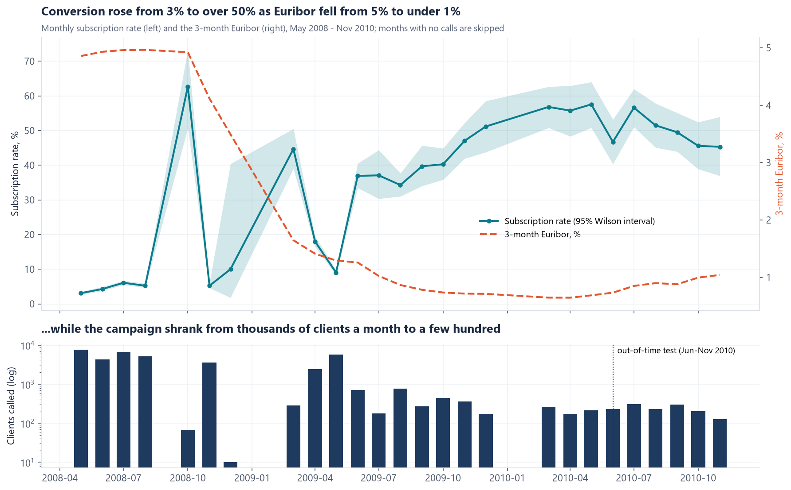
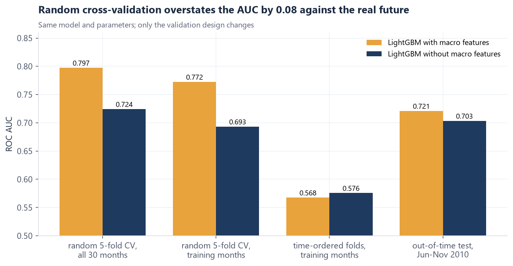
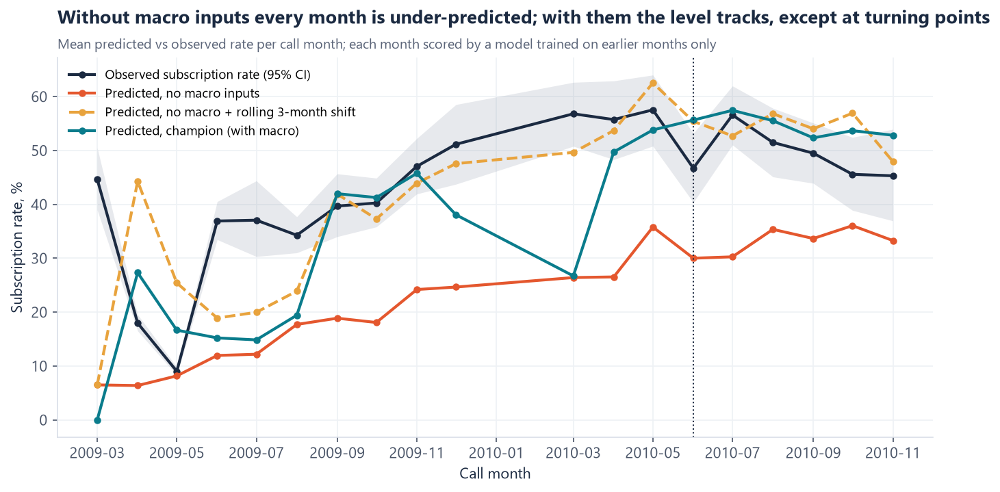
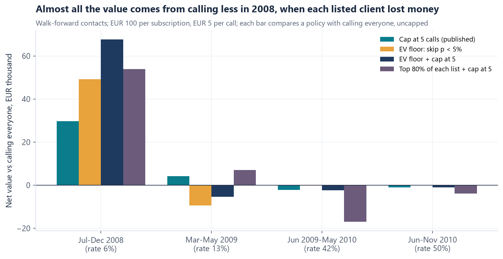

# Data science: bank campaign strategy

The Power BI report answers "who converts, how often to call, and how much of conversion is the economy" with
descriptive analysis and an exact attempt-cap simulation. These notebooks add what the ETL does not have: a propensity
model validated out of time, and a contact policy that combines the score with the cap, priced in money and designed
to be proven with a randomised holdout.

## Lifecycle

| Stage | Notebook | Key output |
|---|---|---|
| Business and data understanding | [01 · EDA](notebooks/01_eda.ipynb) | Conversion rose from 3% to over 50% as Euribor fell, while the call list shrank 20-fold and turned to warm leads; segment lifts shrink within a period; duration excluded (single-feature AUC 0.82, known only after the call); macro inputs act as a date stamp |
| Data preparation | [`features.py`](features.py) + [tests](../tests/test_features.py) | The ETL's own loader and year rebuild; pre-call features only (`duration` and `campaign` never inputs, tested); `pdays = 999` as a flag; walk-forward scoring and recalibration helpers; 10 unit tests |
| Modelling and evaluation | [02 · Propensity model](notebooks/02_propensity_model.ipynb) | The validation trap (random CV 0.80 vs out-of-time 0.72); champion logistic with macro inputs, AUC 0.751; calibration drift with and without macro inputs; segment checks; SHAP vs grouped permutation |
| Decision | [03 · Contact policy](notebooks/03_contact_policy.ipynb) | Cap at 5 reproduced (15% fewer calls, 96% of subscriptions); five policies priced over 29,051 walk-forward contacts; sensitivity; holdout design with sample sizes |
| Deployment and monitoring | [Model card](model_card.md) | Intended use, limits, monitoring triggers, retraining cadence |

## Results

**Validation design changes the answer** (same LightGBM, same parameters)

| Validation | With macro inputs | Without |
|---|---|---|
| Random 5-fold CV, all 30 months | 0.797 | 0.724 |
| Random 5-fold CV, training months only | 0.772 | 0.693 |
| Time-ordered folds, training months | 0.568 | 0.576 |
| **Out-of-time test, Jun - Nov 2010** | **0.721** | **0.703** |

**Out-of-time test** (1,408 contacts, 50% subscribed; trained on May 2008 - May 2010)

| Model | AUC (95% CI) | PR AUC | Brier |
|---|---|---|---|
| Rule: previous campaign outcome | 0.651 (0.628-0.676) | 0.638 | 0.282 |
| Logistic regression, no macro inputs | 0.704 (0.677-0.730) | 0.680 | 0.259 |
| LightGBM tuned, no macro inputs | 0.713 (0.688-0.739) | 0.700 | 0.250 |
| **Logistic regression with macro inputs (champion)** | **0.751 (0.726-0.776)** | **0.723** | **0.210** |
| LightGBM tuned, with macro inputs (challenger) | 0.754 (0.729-0.778) | 0.712 | 0.209 |

LightGBM minus logistic: +0.002 (paired 95% CI -0.010 to +0.014), a tie, so the simpler model is the champion. Macro
inputs add +0.047 to the logistic (CI +0.033 to +0.063). They work by absorbing the regime in training: shuffling them
on the test months moves AUC by only 0.001, while previous-campaign history (0.18) and contact channel (0.06) carry the
ranking.

**Contact policy** (walk-forward scores, Jul 2008 - Nov 2010; EUR 100 per subscription, EUR 5 per call)

| Policy | Calls | Subscriptions | Net value vs calling everyone |
|---|---|---|---|
| Call everyone, no cap (status quo) | 71,564 | 4,212 | - |
| Cap at 5 calls (published) | 62,442 | 4,065 | +EUR 30.9k |
| EV floor: skip p < 5% | 55,082 | 3,783 | +EUR 39.5k |
| Top 80% of each monthly list + cap at 5 | 49,732 | 3,522 | +EUR 40.2k |
| EV floor + cap at 5 | 49,183 | 3,683 | +EUR 59.0k |

Almost all of the gain sits in July-December 2008, when the average listed client lost money; in the 2009-10
high-conversion regime, calling fewer people loses money. The cap is the robust choice (it gains in 10 of 12 cost
scenarios). The recommendation is the cap, wave sizing from observed conversion, the score for call order, and a
randomised holdout before any floor.

## Key figures

| | |
|---|---|
|  |  |
|  |  |

More: [segment rates](figures/01-segment-rates.png), [information value](figures/01-information-value.png),
[test panel](figures/02-test-panel.png), [SHAP](figures/02-shap-beeswarm.png), [ranked calling](figures/03-ranked-calling.png).

## Reproduce

The notebooks read the raw file through the ETL's own `load()`. It looks for `bank.zip` (UCI Bank Marketing) in the
folder named by the `BANK_RAW` environment variable, then in `../_raw`, then in `.raw`, and otherwise downloads it from
UCI into `etl/.raw`. From the repo root:

```bash
pip install pandas numpy scikit-learn scipy statsmodels matplotlib lightgbm optuna shap jupytext nbconvert ipykernel
python -m jupytext --set-kernel python3 --to ipynb --execute ds/notebooks/01_eda.py
python -m jupytext --set-kernel python3 --to ipynb --execute ds/notebooks/02_propensity_model.py
python -m jupytext --set-kernel python3 --to ipynb --execute ds/notebooks/03_contact_policy.py
ruff check ds tests && pytest -q          # unit tests need no raw data
```

Run them in order: notebook 03 reads the champion choice from [`reports/metrics.json`](reports/metrics.json), which
notebook 02 writes. Runtimes on a 4-thread budget: about 30 s, 2-4 min and 20 s.

`dskit/` is the shared helper library used across this portfolio (audit, EDA, evaluation with bootstrap intervals,
explainability, model selection); it is vendored here unchanged and tested by `tests/test_dskit.py`.
